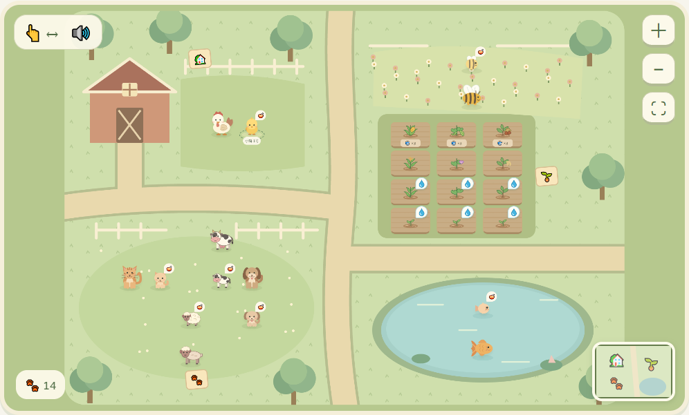
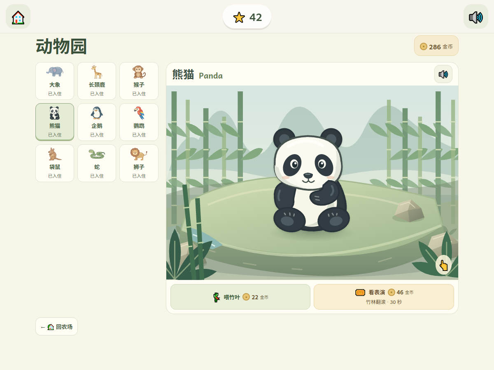
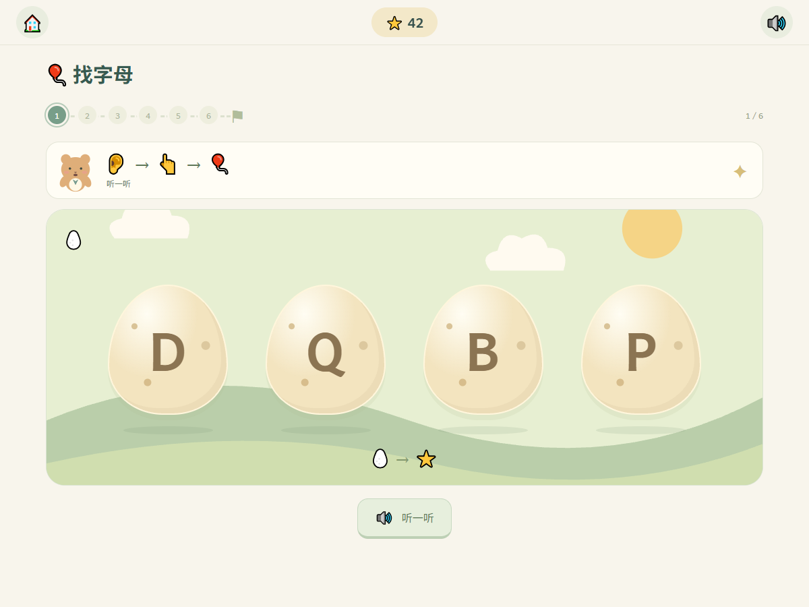
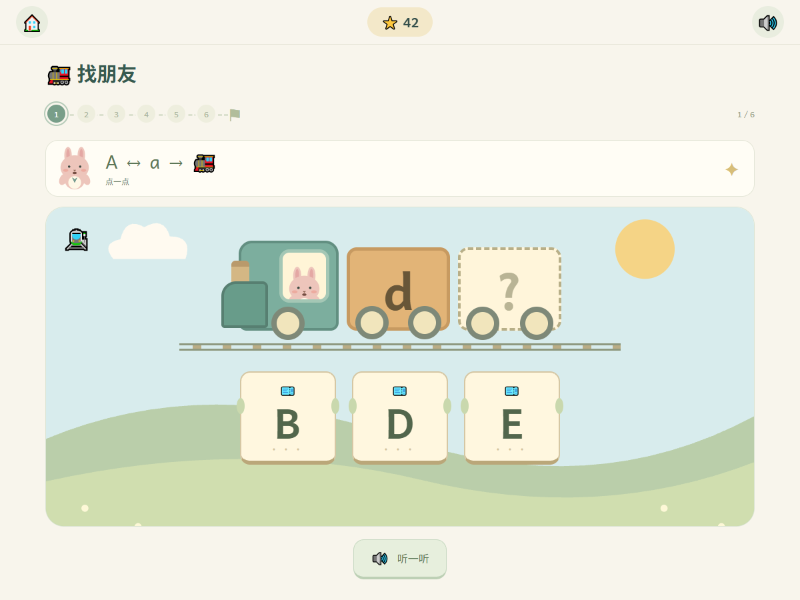

# ABC Park · 字母乐园

## 这个项目的由来

教女儿学英语的过程太过折磨：两个字母认了两个小时，一问还是“不知道”“我忘了”。感觉与其亲自去教她，不如弄个小游戏让她玩，在玩的过程中把字母、单词都学了，于是有了这个项目。

未来或许会一直更新，伴随女儿成长，用游戏的方式来帮助教学。

## 项目简介

给 3-4 岁小朋友的英语字母启蒙小游戏网站，支持**多小朋友档案**：
每个孩子选自己的头像进入，学习进度存在服务器上、跨设备同步；
不带服务器打开时自动变为单机访客模式（进度存本机浏览器）。

**公网部署**（云服务器 Docker 一条命令，或免费静态托管）：见 [DEPLOY.md](DEPLOY.md)。

## 游戏截图

以下为演示存档中的实际游戏画面。

### 农场：种菜、养动物，一起慢慢长大

小院、菜园、草地和池塘连成一张可拖动的地图，动物和作物都有自己的成长过程。



### 动物园：认识动物，也看看它们怎么生活

解锁后，可以和动物打招呼、喂食、看表演。不同动物有各自的栖息环境，图中是熊猫的竹林。



### 字母小游戏：听一听、点一点、配一对

| 听音找字母 | 大小写配对 |
| --- | --- |
| 听字母发音，在气球、泡泡或彩蛋中找到它。 | 帮小火车找到配对的大小写字母。 |
|  |  |

## 本机试玩

### 电脑本机

任选其一：

1. **双击 `start.bat`**（推荐）：自动起本地服务并打开浏览器
2. 直接双击 `index.html`（Chrome/Edge 下功能完整）

### iPad / 手机 / 平板（家里使用，推荐）

不需要任何服务器或云主机，平板和电脑连**同一个 WiFi** 即可：

1. 电脑上双击 `start.bat`，窗口里会列出类似 `http://10.115.10.4:8899` 的地址
2. **第一次使用**：右键 `setup_firewall.bat` → 以管理员身份运行（放行 8899 端口，只需一次）
3. iPad 用 Safari 打开上面的地址
4. 点 Safari 底部「分享」按钮 →「添加到主屏幕」——之后孩子点桌面上的 ABC 图标即可全屏使用，像 App 一样

说明：

- 电脑关机或关掉 start.bat 窗口后，iPad 就访问不了；数据都在电脑的 `server\data\abc.db` 里
- start.bat 现在自带档案管理：电脑和 iPad 访问的是同一个服务，小朋友的进度两端同步
- 手机流量/其他网络下无法访问家里的电脑，那是正常限制（公网部署见 DEPLOY.md）

### 部署到公网（出门也能用，可选）

纯静态站无需购买云主机，免费托管即可。国内访问速度推荐顺序：

| 平台 | 费用 | 说明 |
|---|---|---|
| 腾讯 EdgeOne Pages | 免费 | 国内速度快，默认 `*.edgeone.app` 域名无需备案，上传整个目录即可 |
| Cloudflare Pages | 免费 | `*.pages.dev`，国内多数可用偶有波动，拖拽上传或 wrangler CLI 部署 |
| GitHub Pages | 免费 | 国内访问不稳定，仅作备选 |

HTTPS 和 localhost 已启用 Service Worker 离线缓存；页面和代码优先从网络更新，离线时回退到缓存。系统英语语音能否离线播放取决于设备安装的语音包。

## 功能

| 界面 | 玩法 | 训练目标 |
|---|---|---|
| 👤 小朋友选择 | 点头像进入，无密码；进度云端跟人走 | 多孩子隔离 |
| 🌳 Letter Park 字母乐园 | 26 个字母自由点，看大卡、听字母名和锚定词（A is for Apple） | 字母认知、音形对应 |
| 🎯 Find It! 花样找字母 | 听 "Find the letter B!"，表现形式每题随机轮换：打气球 / 泡泡（10星解锁）/ 破蛋孵小动物（25星解锁） | 听音辨字母（核心） |
| 🧩 Big & Small 大小写配对 | 看到大写 G，从选项里找小写 g | 大小写配对 |
| ⭐ My Stickers 贴纸墙 | 每个字母连续答对 5 次解锁一枚动物贴纸（答错一次重新计数，已解锁不收回） | 收集激励 |
| 🐣 My Farm 农场+商店 | 经营小游戏：拼单词+金币购买幼年动物/种子/饲料；动物喂食长大成年、作物种植收获，果实与成年动物可卖出换金币 | 学习激励闭环 |

设计要点（针对 3-4 岁）：

- 全程语音引导，不需要识字；答错零惩罚，轻声 "Try again"，连错两次自动高亮答案
- 游戏从前 6 个字母（A-F）开始，掌握一个解锁一个，逐步扩展到 26 个
- 「看字选音」反方向练习：看字形、从小动物读音里选出对的，与听音找字母互补
- 出题按遗忘曲线记忆法安排：每轮前段新字母互不重复、尾部复测本轮答错的字母（间隔≥2题）；学过的字母按 1/2/4/7/15 天间隔自动复习，答错次日优先重现；轮长随解锁池 6→8 题
- 干扰项优先选形近易混字母（b/d/p/q、m/w、u/v 等）
- 星星 > 30 后每题选项从 3 个升级为 4 个
- 题目形式每题轮换（皮肤系统 `js/games/skins.js`，新增皮肤只需注册一个渲染器）
- 答对撒彩带、星星飞入计数器、贴纸弹出，全程强反馈

## 技术说明

- 前端纯 HTML/CSS/JS，无框架无构建。英语语音使用浏览器 Web Speech API，游戏提示音使用 WebAudio，农场音效使用本地 MP3。页面和录音可通过 Service Worker 离线使用。
- 后端 `server/app.py`：Python 标准库实现（http.server + sqlite3），零依赖，
  同进程托管静态站点与 `/api/*`；数据只有 `server/data/abc.db` 一个文件。
- 进度同步策略：每次变更立即写本机 localStorage + 节流上传云端；
  断网可继续玩，回网/关页自动补传。
- 字体：Andika（识字启蒙专用）+ Baloo 2（标题），见 `fonts/FONTS-LICENSE.md`。
- `sounds/` 目录可放真人字母音录音（见该目录 README.txt）。

### 动物回应、进食和饮水的声音（v49）

- 点击小鸡、母鸡、猫、狗和蜜蜂会播放对应的实录，幼年和成年鸡、猫、狗各有录音。摸猫会呼噜，鱼摆尾时播放水花和气泡声。

- 五种动物 × 幼年/成年 × 进食/饮水，共 20 组表现，动作约 4.2 秒，在地图和照顾面板同步播放。食物、水碗、花朵、露珠和水流与动物分层绘制，减少文字依赖。

| 动物 | 进食 | 饮水 | 幼年与成年区别 |
|---|---|---|---|
| 小鸡/母鸡 | 啄地上的谷粒，轻脆啄食声 | 低头蘸水、抬头吞咽，吸水及吞咽声 | 小鸡踮脚连续小啄；母鸡先刨地，分次啄食，吞水时抬头更明显 |
| 猫 | 扶碗小口舔食或伏身进食，轻柔咀嚼声 | 伸舌舔水，细小水声 | 小猫扶碗、摆头；成年猫伏身稳定进食，结束后舔嘴 |
| 狗 | 低头咀嚼，颗粒咀嚼声 | 伸舌舔水，较厚的舔水与溅水声 | 小狗身体和尾巴一起晃动；成年狗撑稳前爪、缓慢咀嚼 |
| 蜜蜂 | 口器接近花心吸花蜜，轻嗡与吸食声 | 停在叶片附近饮露，嗡声与细水滴声 | 幼年悬停摇晃、翅膀持续活动；成年停落、收拢翅膀 |
| 鱼 | 张嘴追啄下落的颗粒，轻柔吸食气泡声 | 显示添清水的水流、气泡与舒展的鱼鳍 | 小鱼快速追食、轻快转向；大鱼平稳吸食、舒展尾鳍和缓游 |

- 进食和饮水使用录音剪辑制作拟音，啄食、咀嚼、舔水和气泡按画面动作安排节奏。小蜜蜂飞行时有翅膀嗡声，落定后声音变轻。素材随网站发布，来源见 [农场音频素材](sounds/farm-v1/CREDITS.md)。切换动物、静音、离开农场、进入后台或打开弹窗时会停止上一段声音。
- 当本地 MP3 播放失败或无法及时开始时，网页通过 Web Audio 播放随页提供的对应动物录音。
- 当天已经完成的进食/饮水会出现图形回看按钮，可反复播放相应动作和声音，不改变库存、成长、好感或每日次数。手机滚到照顾面板时依然可播放；减少动画模式保留道具和静态照顾姿态。
- `npm run test:animal-care` 检查全部 28 组照顾动作和播放映射，用浏览器解码 41 个 MP3 并检查响度与长度，同时验证静音、弹窗、手机布局、离线播放和牛羊动画的音效同步。输出 `test-results/animal-care-preview.html` 供集中试听。

### 每日养成、两阶段动物与收益（v47）

- 五种动物都有幼年、成年两套轮廓与细节：小鸡变为带鸡冠、肉垂和尾羽的母鸡；猫狗长出更修长的身体、腿和尾巴；蜜蜂的翅膀、触角与花粉篮更明显；鱼的尾鳍、背鳍和鳞片更丰满。图形长大，点击区域保持原大小；名称、地图形象和照顾面板同步变化。
- 幼年更活泼，成年走动更沉稳，日常和点击动作也分别配置：小猫扑玩、成年猫舔毛伸懒腰，小狗歪头蹦跳、成年狗警觉张望摇尾，幼蜂摇晃试飞、成年蜂访花摆舞，幼鱼短促摆尾、成年鱼舒展鳍尾。蜜蜂的两阶段是游戏化体型成长表现。
- 每只动物每天喂食一次、喂水一次，各消耗一份补给；当天两项都完成后立即成长一次，累计三个照顾日成年，不要求连续三天。先喂食或先喂水都可以，跨日不能拼凑两项；缺少补给不占用次数，同日重复点击不扣资源、不加成长。成年动物也遵守每日各一次的照顾上限。
- 一天按设备本地日期、零点换日；每日完成记录随动物存档保存，刷新、离开农场再回来也不会重置。当页面跨日或后台回到前台时，按钮和地图提示自动更新。面板用食盆/水滴及勾选显示今日照顾、三朵花显示成长，并可点击图示听语音规则。取消原先每 10 小时饥渴下降的机制；漏照顾只暂停成长，不倒退或死亡。
- 摸摸不增加成长、金币、全局爱心或经验，只增加该动物的好感度（陪伴仍计入照顾任务）。每次加一颗心，上限五颗，互动次数不设每日上限。五颗心满后，再摸摸可播放专属亲密动作：鸡蹦跳/收翅贴贴，猫翻滚撒娇，狗开心舞步/转身摇尾，蜜蜂爱心飞舞/花粉舞，小鱼亲亲泡泡/舒展鳍尾。幼年与成年各自有动作。
- 每只新动物记录购买成本和成长期间的补给消耗。饲料 3 金币买 3 份，水 2 金币买 3 份；按补给单价计入投入价值（礼包补给也按此价值计算），购买整包后剩余的库存不计入该动物的成本。成年后继续喂养不抬高成年售价。
- 成年动物可从照顾面板直接出售，商店的出售栏也可以办理。每个品种的成年售价固定，适用于赠送、购买和旧存档中的动物。初始成本、照顾次数和好感度都不会改变售价。下表中的成本和利润按购买后正常培育计算。

| 动物 | 购买价 | 培育成本 | 总成本 | 成年售价 | 净利润 | 净利润率 |
|---|---:|---:|---:|---:|---:|---:|
| 小鸡→母鸡 | 5 | 5 | 10 | 20 | 10 | 100% |
| 蜜蜂 | 8 | 5 | 13 | 26 | 13 | 100% |
| 猫 | 12 | 5 | 17 | 34 | 17 | 100% |
| 狗 | 12 | 5 | 17 | 34 | 17 | 100% |
| 鱼 | 8 | 5 | 13 | 26 | 13 | 100% |
| 奶牛 | 14 | 8.33 | 22.33 | 45 | 22.67 | 约 101% |
| 绵羊 | 12 | 8.33 | 20.33 | 41 | 20.67 | 约 102% |

- 实际培育成本仍记录不完整照顾日消耗的补给。开张赠送的小鸡购买成本为 0。旧存档缺少消耗记录时，按原成长进度及平均补给单价估算。
- 鸡蛋、蜂蜜、珍珠、牛奶和羊毛都可以在仓库和商店出售，单价依次为 3、5、6、8、8 金币。两处都显示单价、库存数量和整批售出的总额。
- `npm run test:animal-growth` 验证十种阶段形象与满好感反应、摸摸不长大、每日限制、三次成对照顾成年、跨日自动刷新、成本和售价、刷新恢复、出售及手机面板；对比图输出到 `test-results/animal-growth-comparison.png`。

### 每种动物最多 6 只（v45）

- 按当前农场里的动物计算名额，小鸡与母鸡合计最多 6 只，其他种类各自最多 6 只。卖出的动物不再占用名额，历史购买次数和动物编号不影响上限。
- 商店用六个脚印格显示名额，住满后点击只播放提示，不进入拼写。拼写完成时再次检查容量，满员不会扣款；卖出后立即可以重新购买。
- 旧存档中已经超过上限的动物全部保留，降到 6 只以下后才能继续购买该种动物。`npm run test:animal-capacity` 覆盖买满、卖出再买、小鸡与母鸡共用名额、拼写期间容量变化、刷新及小屏布局。

### 一张连通的农场地图（v43）

- 小院、菜园、草地和池塘通过小路连成一张地图。全部动物同时存在，取消按区域过滤和翻组；鸡、猫、狗共享陆地区域，蜜蜂在花丛活动，鱼在池塘里游动。镜头外的动物也会继续活动。
- 鼠标按住拖动、手机单指拖动查看；双指缩放，或用大号 ＋／− 按钮。右下角小地图和总览按钮可以找回整个农场，四个区域图标只负责移动镜头。
- 从动物或菜地上开始拖动不会触发点击。点动物仍有个性化动作和叫声；总览时点动物会拉近，喂养、浇水、种植后保留镜头位置。动物增加时地图扩大，不隐藏已购买的动物。
- 动物避开房屋、农田和彼此；相机与走动位置不写入养成存档。切换小朋友清空镜头记忆，离开农场清理拖动、动画和观察器。
- `npm run test:farm-map` 检查 320／390／1440 像素宽度下的完整地图、鼠标和触屏拖动、误触隔离、双指缩放、总览、照顾后的镜头保留、空农场及切换档案；`npm test` 另模拟最多 125 只动物活动，检查建筑、农田、池塘与碰撞边界。触屏测试使用浏览器模拟，真实 iPad 手感仍需设备试玩。

### 会自己活动的小动物（v42）

- 每只动物独立选择走动、停留和小动作：鸡啄地、猫舔毛伸懒腰或打盹、狗嗅地摇尾巴、蜜蜂飞舞访花、小鱼游动吐泡泡。速度与停留节奏各不相同。
- 点击动物会原地回应：小鸡扑翅蹦跳、猫蹭蹭、狗摇尾巴鞠躬、蜜蜂绕圈、小鱼跃动水花，伴随对应的声音。摸猫会呼噜，喂食和饮水有专门的动作及声音。
- 场景下方有直接喂食、喂水、摸摸头的图标按钮。点击动物不再自动滚动到照顾面板；照顾后保留当前站位。鼠标移近或键盘聚焦时暂时停住，便于点选。
- 自主活动不写入存档、不增加成长或产出；原来的独立养成规则保留。动物避免重叠，小鱼限制在池塘内，蜜蜂活动区域避开农田。v43 起全部动物放在连通地图上。
- 隐藏页面、离开场景或打开弹窗会暂停活动并清理动物声音。静音立即生效，连续互动不会叠加叫声；系统减少动态效果开启时关闭自主位移，保留点选反馈。
- `npm run test:farm-life` 覆盖自主移动、五种点击反应、本地动物声音的播放与停止、就地照顾、静音、后台和切页清理、多屏幕布局。专项规则测试还模拟了两分钟活动，检查边界与碰撞。

### 听音拼词与图示操作（v41）

- 商店用商品图片显示目标，不在商品卡、听音按钮或空格中提前显示英文答案。购物需要听单词并依次选择字母；字母盘打乱顺序，并从已掌握字母中加入最多两个干扰项。小鸡用鸡蛋图片对应 EGG。
- 答对后才把所选字母放进空格。点灯泡或累计输错三次时，弹窗短暂展示整词卡并读一遍。卡片收起时清空已拼字母，从第一格重新拼。只点喇叭重听会保留进度。完整拼对且播报完成后才扣款，关闭弹窗或切页即可取消购买。
- 农场、商店和小游戏的常用指引改为大图标、操作图示及短标签：食物和水的需求用图示格表示，成长用花朵表示，订单直接画出需要的物品。复杂建设说明收进可展开的信息项。
- 中文玩法指引与英语字母、单词共用可取消的语音队列，分别选择对应语言的系统声音。静音时可点购物弹窗的喇叭主动开启声音。实际中文出声取决于设备语音包，自动化测试使用模拟语音事件。
- 验证覆盖答案初始隐藏、整词提示后从头拼、重复字母、重播、静音恢复、取消购买，以及 320 像素宽度下五字母拼词和大按钮布局。

### 多只动物一起养成（v40）

- 同一种动物可以反复拼词购买，每次按原价扣金币。商店显示当前已养数量；字母掌握、余额检查及取消购买仍然有效。
- 每只动物有独立标识和固定编号，分别记录饱食、饮水、成长及生产计时。购买后自动选中新伙伴，照顾、收集或送走一只不会影响其他动物；送走后不会重新编号。
- v43 起全部动物在同一张连通地图上活动，不再分组或翻页；v45 起每种动物最多同时饲养 6 只。蜜蜂与农田分开排列，兼容扩建后的 12 块地。
- 老存档只补充编号，原动物、成长和产出保留。自动化测试覆盖重复购买、独立照顾与产出、刷新恢复、单只送走及 320／390／820／1440 像素下的多动物布局。

### 小游戏表现升级（v39）

- **字母寻宝记**：气球嘉年华、海底泡泡、破壳小伙伴三个独立场景，沿用 0／10／25 星的解锁门槛。答对揭开星星或角色奖励，答错温和回弹，连续答错两次给出指引。
- **森林小剧场**：本地 SVG 动物角色轮流读字母，聚光、高亮和嘴部动画由实际语音开始事件驱动。读完后开放选择，重播会清理上一轮角色状态。
- **字母小火车**：点字母车票完成大小写配对，正确字母飞进空车厢。所有选项使用相同字色，避免颜色提示答案。
- 统一星星旅程进度、角色鼓励和一轮结束的庆祝面板。语音播完后保留足够的视觉反馈时间，再进入下一题；练习题目、贴纸与星星计分规则保持原样。
- 点击区域保持稳定，浮动动画只作用于图形；手机上四个选项排列成两行。支持键盘焦点和系统减少动态效果设置，离开页面会清理语音、飞行字母和粒子。

### 动物园

主页和农场都可进入动物园。动物园与农场共用当前孩子的金币，动物确认引入后留在该档案。喂食和表演按次扣金币，播放期间不会重复收费。每场表演约 30 秒，分三段动作，画面下方显示当前动作和进度。浏览器切到后台时暂停计时，回到前台后继续。

九种动物各有河岸、草原、竹林、冰岸等生活环境。场景通过远景、立体地面、接触阴影和前景遮挡表现纵深，动物向远处移动时会变小。未引入时只显示静态预览和锁标记；确认引入后才有日常走动、跳跃、飞行和点击回应。直接点动物可以免费打招呼，触摸回应结束后继续活动；喂食和表演期间暂停日常互动。系统开启“减少动态效果”时保留静态场景和回应爱心。

动物的脚步与移动路线共用节奏，停下来会收腿站稳；企鹅左右迈脚配合摇摆，猴子跃起时收腿摆尾。袋鼠起跳屈腿、落地缓冲，影子留在地面；鹦鹉起飞时展开双翼、收起脚爪，落回枝头后收翼。各动物的轮廓、眼神、脚爪和毛色采用柔和的绘本风格。

大象用鼻子卷干草，长颈鹿伸舌卷树叶，猴子用手剥香蕉，熊猫用爪抱竹枝，鹦鹉抓住坚果啄开外壳。企鹅用喙夹鱼，袋鼠低头啃草，蛇整颗吞鸟蛋。这些喂食动画各约 4 秒。

狮子的喂食按钮会轮流播放追兔子和追小鸡，每次约 5.5 秒，花费 36 金币。兔子一路蹦跳，小鸡边跑边拍翅膀，狮子会伏低、加速，最后扑住猎物。

| 动物 | 引入 | 每次喂食 | 每场表演 |
|---|---:|---:|---:|
| 大象 | 360 | 12（干草） | 24（大象喷泉） |
| 长颈鹿 | 520 | 16（树叶） | 32（草原巡游） |
| 猴子 | 360 | 20（香蕉） | 40（林间荡秋千） |
| 熊猫 | 840 | 22（竹叶） | 46（竹林翻滚） |
| 企鹅 | 480 | 24（小鱼） | 52（冰坡滑行） |
| 鹦鹉 | 540 | 26（果仁） | 58（彩环飞行） |
| 袋鼠 | 1200 | 28（嫩草） | 64（草地三连跳） |
| 蛇 | 680 | 32（鸟蛋） | 72（岩石探险） |
| 狮子 | 1520 | 36（追兔子或小鸡） | 80（狮王登台） |

海豹和海豚的已入住记录保留在原档案中，供后续海洋馆读取。猴子与蛇按各自的价格单独引入。

点动物名称旁的喇叭可以免费听英文名称。余额不足时，按钮会显示还差多少金币。浏览器测试 `npm run test:zoo` 覆盖解锁门槛、远近移动、鼠标/键盘/触摸回应、购买、付费活动、切页、读档和小屏布局。

### 奶牛与绵羊

- 商店拼写 `COW`、`SHEEP` 可买到小牛和小羊。每天各喂一次食物和水，累计照顾五天后长大。成年后的照顾另计，累计三天可以挤一次奶或剪一次羊毛，完成动作后重新累计。
- 可以剪毛的绵羊会长出厚厚的羊毛。动画中剪刀移过羊背，毛团落下，剪完后能在草地上看到短毛的样子。挤奶动画会显示牛奶流进桶里。每次挤奶或剪毛会在草地上留下一份产物，点地图上的牛奶或羊毛图标即可放进仓库。
- 牛会低头卷住草、扯起后缓慢咀嚼。羊用嘴唇贴着短草小口咬。喝水时，两者都把口鼻靠近水面吸水，牛用较慢的吸水节奏，羊用较轻的短吸声。幼年和成年分别使用动作录音，进食使用吃草实录，饮水使用吸水与吞咽拟音。音效开始后对齐动画时间，录音可离线播放。

### 农场经营和作物生长

农场现在有完整的「播种 → 浇水 → 收获 → 邻居订单 → 等级与建设」循环，同时保留拼单词购买的英语学习环节。

- 每个档案首次进入新版会领到 3 颗坚果种子、1 颗豆种子、3 份饲料和 3 份水；没有动物的农场会获得一只小鸡。礼包仅一次，已有动物、金币和农田保留。
- 点空地选择库存种子。坚果、豆子和玉米从种子开始，依次发芽、长叶、开花和成熟。每块地每天可以浇一次水，第二天长一阶段。漏浇时停在原阶段，补浇后继续生长。点击成熟的作物，果实飞进篮子，每块地收获 3 份。升级前已经种下的作物按原有时间和产量收获。
- 母鸡、成年蜜蜂和成年鱼从长大后的下一天开始，每天产出一份鸡蛋、蜂蜜或珍珠。鸡蛋在小院，蜂蜜在花田，珍珠在池塘边。同种产物显示为一堆，点一下就能拾取整堆。「待拾取」一栏可以把地图移到产物旁。地上的产物会随存档保留，出售动物后已产出的物品也可拾取。
- 订单板有 3 张常驻邻居订单，不限时。交付会扣除仓库物品，发放金币和经验，并补充新订单。仓库也可以按普通价格出售收获。
- 每 25 经验提升一级；收获、订单、照顾和成长任务可获得经验。Lv.2 可扩建到 9 块地（25 金币）、升级动物小屋（30 金币）；Lv.3 可扩建到 12 块地（45 金币）、建灌溉站（35 金币）。鸡蛋、蜂蜜和珍珠每只动物基础可在地上留 3 份，升级小屋后可留 5 份。建好灌溉站后，给作物浇水不扣库存。
- 顶部的成长任务引导播种、照顾、收获、订单、扩建；任务奖励逐项领取，每项仅能领一次。
- 快速拼写时，字母（包括 EGG 中的两个 G）逐个排队播报，再读完整单词。重复的照顾反馈合并，系统意外截断一句话时完整重试一次。

### 农场界面与声音基础（v37）

- 小院、菜园、草地、池塘采用本地 SVG 插画；点动物后直接选择摸一摸、喂食、喂水，显示饱腹、饮水和成长进度。
- 点空地选择种子，拼对后种在选中的地块；商店分为小伙伴、种子、食物和水，收获篮可展开兑换金币。
- 保留旧档案、价格、贴纸解锁条件和成长规则。新购买动物的饱腹/饮水为 2/3，可以马上喂一次；不再使用追着游走动物投喂的交互。
- 语音使用统一队列，依据实际播报结束继续游戏；重播、静音、切页会清理旧语音任务，录音也接入停止和失败回退。优先选择本机英语语音。
- 农场读取不再触发 localStorage 写入和云同步；照顾在点击时完成保存，动画不再延迟修改档案。

### 开发验证

网页仍可直接静态部署，无需构建。Node.js 仅用于测试和独立预览：

```powershell
npm ci
npm test
npm run test:browser
npm run test:games
npm run preview
```

`npm test` 覆盖语音冷启动、长句、连续拼写、取消、重播、静音、录音回退，以及种植、产出、订单、扩建、礼包和任务的库存与奖励计算。浏览器测试默认使用本机 Edge，语音事件使用模拟器，验证购买、照顾、种植、浇水、收获、订单、扩建、产出、刷新保存以及桌面、平板、手机布局，截图写入 `test-results/`。真实系统语音与 iPad Safari 出声效果需在设备上试听。

`npm run preview` 打开 `http://127.0.0.1:8900` 的独立访客预览，不连接现有档案数据库。正常使用仍通过 `start.bat` 启动。

`npm run test:games` 验证三个小游戏的整轮答题、温和提示、三种寻宝场景、语音角色高亮、重播、火车配对与切页清理；检查 320／390／820 像素宽度、四选项和八题进度条，截图输出到 `test-results/game-*.png`。

## 目录结构

```
kids_english/
├── index.html            # 单页应用入口
├── sw.js                 # Service Worker（离线缓存）
├── start.bat             # 本机一键启动（前后端一体）
├── setup_firewall.bat    # 一次性放行 8899 端口（管理员运行）
├── Dockerfile / docker-compose.yml   # 云服务器部署
├── server/app.py         # 后端：档案 + 进度 API（SQLite）
├── manifest.webmanifest  # PWA 清单
├── icons/                # 主屏幕图标
├── css/style.css
├── js/
│   ├── data.js           # 26 字母数据、形近映射、出题算法
│   ├── audio.js          # TTS、游戏提示音和农场录音播放
│   ├── storage.js        # 进度存储（本机缓存 + 云同步）
│   ├── profiles.js       # 小朋友档案（选择/创建/切换/管理）
│   ├── confetti.js       # 庆祝彩带
│   ├── app.js            # 路由、启动流程与顶栏
│   └── games/            # letterPark / skins(皮肤系统) / listenFind / matchCase / stickers
├── fonts/                # 字体（OFL）
└── sounds/               # 可选真人字母音录音
```

## 升级路线（未做）

- 字母描红（Canvas 手指描字形）
- ABC Song 唱歌跟读模式
- 每日打卡、混淆字母专项关（b/d 专项）
- PWA 离线安装、家长进度面板
- 下一个学习阶段：CVC 单词拼读（sat/pin/cat…）

## 许可证

除第三方资源及另有许可声明的文件外，本项目采用 [GNU General Public License v3.0](LICENSE)（SPDX：`GPL-3.0-only`）。

第三方依赖、字体和音频保留各自原有许可证。字体许可见 [字体清单](fonts/FONTS-LICENSE.md)，音频来源、署名及许可见 [音频素材说明](sounds/farm-v1/CREDITS.md)。
